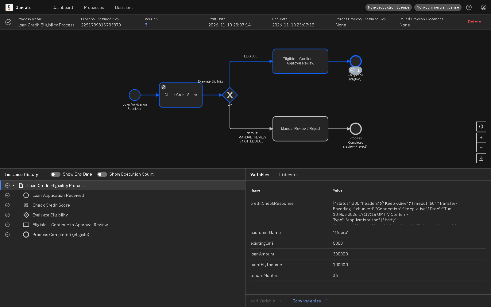
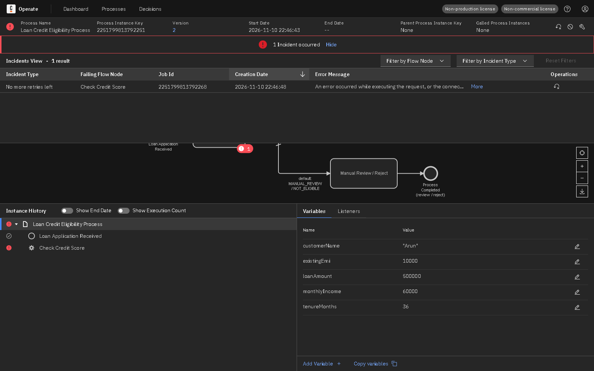
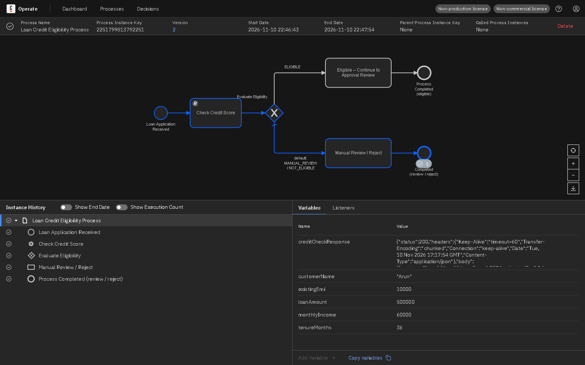

# Live Demo: Loan Credit Check with the Camunda 8 REST Connector

This folder is the live demo for the presentation. It follows the practical tutorial *Building a Loan Credit Check with Camunda 8 REST Connector*.

A Spring Boot API works out a demo credit assessment. Camunda calls that API with the **REST API Connector**, so there is no service-task worker calling the URL. Camunda saves the JSON reply in `creditCheckResponse`, and an exclusive gateway picks the path from the decision.

> This is a teaching simulation. It does not contact any real credit bureau, and its score rules are invented.



## What is in this folder

| Item | What it is |
|---|---|
| `credit-check-service/` | Spring Boot API from the tutorial: `POST /api/credit-check` on port 8081 |
| `Loan_Credit_Eligibility_Process.bpmn` | The BPMN process, with the REST Connector on **Check Credit Score** |
| `evidence/` | Real Operate screenshots and test results from Camunda 8 Run 8.8.32 |

## The process

1. **Loan Application Received** is the start event.
2. **Check Credit Score** is a service task with the **REST Outbound Connector** template. It sends a POST to the API.
3. **Evaluate Eligibility** is an exclusive gateway:
   - `=creditCheckResponse.body.decision = "ELIGIBLE"` leads to **Eligible – Continue to Approval Review**.
   - The default flow leads to **Manual Review / Reject**. Both MANUAL_REVIEW and NOT_ELIGIBLE take this path.
4. Both paths end at **Process Completed**.

## REST Connector settings

| Field | Value |
|---|---|
| Authentication | None |
| Method | POST |
| URL | `http://localhost:8081/api/credit-check` |
| Query parameters | empty |
| Headers | `={"Content-Type": "application/json", "Accept": "application/json"}` |
| Request body | `={"customerName": customerName, "monthlyIncome": monthlyIncome, "existingEmi": existingEmi, "loanAmount": loanAmount, "tenureMonths": tenureMonths}` |
| Connection / read timeout | 20 s / 20 s |
| Result variable | `creditCheckResponse` |
| Retries | 3, with a 2 s backoff |

`localhost` works here because Camunda 8 Run runs the connector on the same Windows machine. If Camunda runs in Docker, use `http://host.docker.internal:8081/api/credit-check` instead (tutorial section 2.1).

## Step by step

### 1. Start Camunda 8 Run

```powershell
cd C:\Users\punee\Cambunda\c8run-8.8.32
.\c8run.exe start
```

Wait until you see *All processes are running and healthy*. Then open <http://localhost:8080/operate> and log in with `demo` / `demo`.

### 2. Start the Spring Boot API (second PowerShell window)

```powershell
cd "C:\Users\punee\workflo automation\Camunda8-Labs-1-to-3\demo-rest-connector\credit-check-service"
.\mvnw.cmd spring-boot:run
```

Wait for *Tomcat started on port 8081*.

### 3. Test the API on its own first

```powershell
Invoke-RestMethod -Method Post -Uri http://localhost:8081/api/credit-check -ContentType 'application/json' -Body '{"customerName":"Arun","monthlyIncome":60000,"existingEmi":10000,"loanAmount":500000,"tenureMonths":36}'
```

The reply should include `decision = MANUAL_REVIEW` and `emiRatio = 44.35`. The tutorial text prints a score of 900 for this case, but its own code returns 750. The decision is the same either way.

### 4. Open the model and show the REST Connector

1. In Camunda Modeler, choose **File → Open → Loan_Credit_Eligibility_Process.bpmn**.
2. Click **Check Credit Score**. The properties panel shows the template **REST Outbound Connector**.
3. Go through each field in the table above.

### 5. Deploy

Click the **rocket** icon and choose **Camunda 8 Self-Managed**. Set the cluster endpoint to `http://localhost:26500` and Authentication to **None**, then click **Deploy**.

### 6. Start an instance

Click the **play ▶** icon and paste these variables:

```json
{"customerName": "Arun", "monthlyIncome": 60000, "existingEmi": 10000, "loanAmount": 500000, "tenureMonths": 36}
```

### 7. Check the result in Operate

Open the instance. The path should go to **Manual Review / Reject**. Under Variables, `creditCheckResponse` holds `status`, `headers` and `body`. Click **Check Credit Score** to see the URL, method and body the connector sent.

### 8. Show all three routes

| Test | Income · EMI · Loan · Months | API decision | Path |
|---|---|---|---|
| A Meera | 100000 · 5000 · 300000 · 36 | ELIGIBLE | Eligible – Continue to Approval Review |
| B Arun | 60000 · 10000 · 500000 · 36 | MANUAL_REVIEW | Manual Review / Reject |
| C Ravi | 20000 · 15000 · 1000000 · 24 | NOT_ELIGIBLE | Manual Review / Reject |

All three were run on Camunda 8 Run 8.8.32 and took the expected path (`evidence/test-results.json`).

### 9. Failure handling (optional)

1. Stop Spring Boot with Ctrl + C, then start another instance.
2. The connector retries 3 times. Operate then shows an incident, *No more retries left*, on **Check Credit Score**.
3. Start Spring Boot again and click **Retry** in Operate. The same instance carries on and completes.

| Incident | After retry |
|---|---|
|  |  |

## Troubleshooting

| Symptom | Likely cause | Fix |
|---|---|---|
| Connection refused | Spring Boot is stopped, or the port is wrong | Start it and check port 8081 |
| 404 Not Found | Wrong path | Use `POST /api/credit-check` |
| 400 Bad Request | JSON field names or types are wrong | Check spelling; send numbers, not strings |
| Gateway takes the wrong path | Wrong variable path or text | Inspect `creditCheckResponse` in Operate |
| Task never runs | Connector runtime is not running | Restart Camunda 8 Run |
